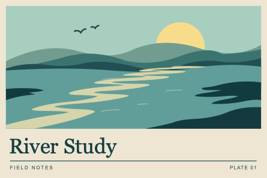

# ArtCraft Quick Look

Seleziona un progetto ArtCraft, una sessione di SoundCraft o un file SVG nel Finder e premi **Spazio** per vederne il contenuto. Seleziona più revisioni e scorrile con i tasti freccia. ArtCraft Quick Look aggiunge sia le miniature nelle cartelle sia le anteprime statiche più grandi.

**[Scarica per macOS](https://github.com/Roccobot/CraftLook/releases/latest)** · [English README](README.md)

## Provalo

1. Scarica lo ZIP dall'[ultima release](https://github.com/Roccobot/CraftLook/releases/latest). Contiene i renderer e funziona sui Mac Intel e Apple silicon con macOS 13 o successivi.
2. Estrai l'archivio, sposta **ArtCraft Quick Look** in **Applicazioni** e aprila una volta. Questa build ha una firma ad hoc e non è notarizzata da Apple. Al primo avvio Gatekeeper può chiedere un'autorizzazione. [Guida Apple](https://support.apple.com/it-it/102445)
3. Nel Finder seleziona un file compatibile e premi **Spazio**. Se il Finder mostra solo un'icona generica, controlla che le estensioni di ArtCraft Quick Look siano attive nelle Impostazioni di Sistema e che **Mostra anteprima icona** sia attivo nelle opzioni Vista del Finder.

Puoi provarlo con [River Study, un piccolo progetto VectorCraft](https://raw.githubusercontent.com/Roccobot/CraftLook/main/examples/river-study.vectorcraft). Salva il file con l'estensione `.vectorcraft`. L'immagine qui sotto è la miniatura che macOS ha generato da quel file.



## File supportati

| App o formato | Estensione | Che cosa vedi |
| --- | --- | --- |
| FigCraft | `.figcraft` | L'impaginato disegnato dal renderer. Anche una miniatura salvata può fornire l'anteprima. |
| DesignCraft | `.designcraft` | Il progetto disegnato dal renderer, con l'anteprima salvata come riserva. |
| VectorCraft | `.vectorcraft` | La prima tavola di un PDF incorporato, un'anteprima salvata o una tavola appena disegnata. Sono supportati i progetti compressi con gzip. |
| TextureCraft | `.tcraft` | La miniatura salvata o una vista del progetto disegnata dal renderer. |
| PhotoCraft | `.pcraft` | Il miglior composito o la miglior miniatura salvati, da un archivio o da un pacchetto di progetto. |
| SolidCraft | `.sc`, `.solidcraft` | Una vista del progetto disegnata dal renderer, senza la griglia del piano e gli assi. |
| FilmCraft | `.fcproj` | Il fotogramma della sequenza attiva sotto la testina di riproduzione salvata. Un rettangolo verde arrotondato prende il posto di ogni immagine che Quick Look non può leggere. |
| MaterialCraft | `.mcraft` | Il materiale disegnato sulla scena 3D dell'app. |
| EffectCraft | `.ecproj`, `.ecprojx` | La composizione attiva al suo istante corrente. |
| SoundCraft | `.scraft` | La timeline: le tracce, le clip dove e quanto suonano, le note MIDI, i marker e la testina. |
| Documento Photoshop | `.psd` | Il composito che macOS legge con ImageIO. Photoshop non serve. |
| Immagine SVG | `.svg` | Il disegno reso da VectorCraft, testo compreso. |

Le anteprime di FigCraft e DesignCraft arrivano a 2048 pixel sul lato più lungo. Le miniature del Finder usano un'immagine salvata, quando c'è. I renderer inclusi lavorano sul Mac, tramite un servizio in sandbox, su una copia temporanea del file richiesto. I progetti che usano file esterni al progetto possono apparire diversi: Quick Look non lascia che il renderer li legga, quindi in un fotogramma di FilmCraft ogni immagine di un altro file diventa un rettangolo verde arrotondato della sua misura, al suo posto. Il disegno ha un limite di 12 secondi e un limite di 256 MiB sul file.

PdfCraft lavora sui normali file PDF, che macOS mostra da sé.

macOS usa una sola estensione Quick Look per ogni tipo di file. Se anche un'altra app mostra i file SVG, come Looq o Gapplin, disattiva la sua estensione nelle Impostazioni di Sistema, in Generali, Elementi login ed estensioni, Quick Look, perché sia ArtCraft Quick Look a mostrarli.

## Build e controlli

Serve un Mac con gli strumenti a riga di comando di Xcode e Python 3. Lo script di preparazione scarica le release universali delle CLI elencate in [THIRD_PARTY.md](THIRD_PARTY.md), ognuna all'ultima versione, pre-release comprese, ne controlla gli SHA-256 e ne conserva gli avvisi.

```sh
python3 scripts/prepare_renderers.py "$PWD/engines"
./build.sh "$PWD/build" "$PWD/engines"
```

Il risultato è `build/ArtCraft Quick Look.app`. Per usare gli ZIP originali già scaricati, passa `--archives /percorso/degli/archivi` allo script Python. Per una build più piccola, che legge solo le anteprime incorporate, esegui `./build.sh "$PWD/build-embedded"` in una cartella di build nuova.

Dopo la build, esegui i controlli della lettura dei documenti con questi comandi.

```sh
xcrun swiftc Sources/Archive.swift Sources/DocumentImage.swift Sources/Drawing.swift Sources/Timeline.swift Tests/RenderCheck.swift -o build/rendercheck
python3 Tests/check.py build/rendercheck
```

I controlli dei renderer scrivono un piccolo progetto per ogni formato che solo un renderer può mostrare, con lo strumento a riga di comando di quel renderer, poi li disegnano.

```sh
python3 Tests/samples.py "$PWD/engines" build/samples
xcrun swiftc -parse-as-library Sources/Archive.swift Sources/DocumentImage.swift Sources/Drawing.swift Sources/Timeline.swift Sources/RenderXPC.swift Sources/HeadlessRenderer.swift Tests/HeadlessCheck.swift -o build/headlesscheck
build/headlesscheck "build/ArtCraft Quick Look.app/Contents/PlugIns/Thumbnail.appex/Contents/XPCServices/CraftRender.xpc/Contents/Helpers" build/samples/* examples/river-study.vectorcraft
```

Il controllo del servizio manda gli stessi file al servizio dei renderer dell'app, nella sua sandbox, tutti insieme, e vuole un'immagine per ognuno.

```sh
Tests/service_check.sh "build/ArtCraft Quick Look.app" build/samples/* examples/river-study.vectorcraft
```

## Fonti dei formati

- [FigCraft](https://github.com/storytold/figcraft/blob/main/crates/format/src/lib.rs)
- [DesignCraft](https://github.com/storytold/craft-libs/blob/main/crates/designcraft-format/src/lib.rs)
- [VectorCraft](https://github.com/storytold/vectorcraft/blob/main/crates/format/src/lib.rs)
- [TextureCraft](https://github.com/storytold/texturecraft/blob/main/crates/formats/src/project_file/mod.rs)
- [PhotoCraft](https://github.com/storytold/photocraft/blob/main/book/src/formats/pcraft.md)
- [SolidCraft](https://github.com/tangency-labs/solidcraft), [FilmCraft](https://github.com/storytold/filmcraft), [MaterialCraft](https://github.com/storytold/materialcraft/blob/main/packaging/macos/Info.plist.in) ed [EffectCraft](https://github.com/storytold/effectcraft): il tipo che ogni app dichiara e l'immagine che disegna il suo strumento a riga di comando
- [SoundCraft](https://github.com/storytold/soundcraft): il tipo che l'app dichiara e la sessione che salva il suo strumento a riga di comando
- [Apple Quick Look UI](https://developer.apple.com/documentation/quicklookui/qlpreviewprovider) e [Quick Look Thumbnailing](https://developer.apple.com/documentation/quicklookthumbnailing/qlthumbnailprovider)

## Segnalazioni e riconoscimenti

Per un'anteprima vuota o sbagliata, indica l'estensione, la versione di macOS, la versione dell'app che ha salvato il file e, se puoi, un piccolo progetto da condividere. [Segnala un problema di anteprima](https://github.com/Roccobot/CraftLook/issues/new?template=preview.yml)

ArtCraft Quick Look è un progetto indipendente della comunità. I renderer vengono dal gruppo di ArtCraft, da Tangency Labs per SolidCraft, e dai loro collaboratori. [Release originali e riconoscimenti](THIRD_PARTY.md)

Il codice Swift, gli script di build e i test sono distribuiti con [licenza MIT](LICENSE). Per il martin pescatore valgono [condizioni separate](ARTWORK.md).
