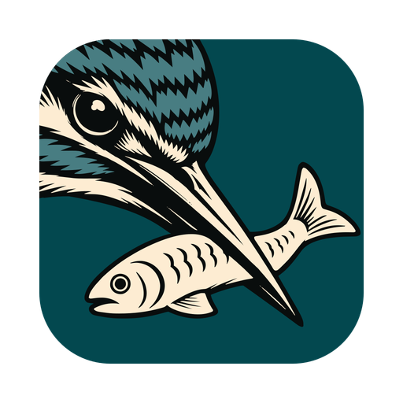
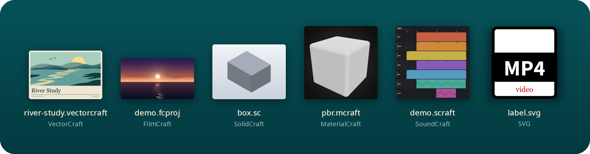

<p align="center">
  
</p>

<h1 align="center">CraftLook</h1>

<p align="center">Miniature nel Finder e anteprime con la barra spaziatrice per i progetti ArtCraft, le sessioni di SoundCraft e i file SVG.</p>

<p align="center">
  <a href="https://github.com/Roccobot/CraftLook/releases/latest"></a>
  
  <a href="LICENSE"></a>
</p>

<p align="center">
  <b><a href="https://github.com/Roccobot/CraftLook/releases/latest">Scarica per macOS</a></b> · <a href="README.md">English README</a>
</p>

Seleziona un progetto ArtCraft nel Finder e premi **Spazio** per vederne il contenuto, senza aprire l'app che l'ha creato. Seleziona più revisioni e scorrile con i tasti freccia. Le cartelle mostrano miniature vere al posto delle icone generiche.



<p align="center"><sub>Anteprime disegnate da CraftLook a partire dai file d'esempio del progetto.</sub></p>

## Formati supportati

| App o formato | Estensione | Che cosa vedi |
| --- | --- | --- |
| FigCraft | `.figcraft` | L'impaginato disegnato dal renderer. Anche una miniatura salvata può fornire l'anteprima. |
| DesignCraft | `.designcraft` | Il progetto disegnato dal renderer, con l'anteprima salvata come riserva. |
| VectorCraft | `.vectorcraft` | La prima tavola di un PDF incorporato, un'anteprima salvata o una tavola appena disegnata. Sono supportati i progetti compressi con gzip. |
| TextureCraft | `.tcraft` | La miniatura salvata o una vista del progetto disegnata dal renderer. |
| PhotoCraft | `.pcraft` | Il miglior composito o la miglior miniatura salvati, da un archivio o da un pacchetto di progetto. |
| SolidCraft | `.sc`, `.solidcraft` | Una vista del progetto disegnata dal renderer, senza la griglia del piano e gli assi. |
| FilmCraft | `.fcproj` | Il fotogramma della sequenza attiva sotto la testina di riproduzione salvata. Un rettangolo verde arrotondato prende il posto di ogni immagine che Quick Look non può leggere. |
| MaterialCraft | `.mcraft` | Il materiale disegnato sulla scena 3D dell'app. |
| EffectCraft | `.ecproj`, `.ecprojx` | La composizione attiva al suo istante corrente. |
| SoundCraft | `.scraft` | La timeline su una scheda quadrata: le tracce, le clip dove e quanto suonano, le note MIDI, i marker e la testina. |
| Documento Photoshop | `.psd` | Il composito che macOS legge con ImageIO. Photoshop non serve. |
| Immagine SVG | `.svg` | Il disegno reso da VectorCraft, testo compreso. |

PdfCraft lavora sui normali file PDF, che macOS mostra da sé.

## Installazione

1. Scarica lo ZIP dall'[ultima release](https://github.com/Roccobot/CraftLook/releases/latest).
2. Estrai l'archivio, sposta **CraftLook** in **Applicazioni** e aprila una volta.
3. Nel Finder seleziona un file compatibile e premi **Spazio**.

CraftLook si aggiorna da sé (vedi [Aggiornamenti](#aggiornamenti)). Fino alla versione 0.2.5 si chiamava ArtCraft Quick Look: se hai quell'app, cancellala prima di installare CraftLook, perché le due non gestiscano gli stessi file. Per provarla subito, scarica [River Study, un piccolo progetto VectorCraft](https://raw.githubusercontent.com/Roccobot/CraftLook/main/examples/river-study.vectorcraft) e tieni l'estensione `.vectorcraft`.

### Primo avvio

CraftLook è firmata con un Developer ID e notarizzata da Apple: Apple l'ha controllata per escludere software dannoso, quindi Gatekeeper la apre senza avvisi, come ogni altra app scaricata. La sua finestra ha un pulsante, **Open System Settings**, che porta dritto alle estensioni di Quick Look, dove attivare o disattivare CraftLook.

Se il Finder mostra ancora un'icona generica, controlla che le estensioni di CraftLook siano attive nelle **Impostazioni di Sistema**, in **Generali**, **Elementi login ed estensioni**, **Quick Look**, e che **Mostra anteprima icona** sia attivo nelle opzioni Vista del Finder.

### Aggiornamenti

Dalla versione 0.4.0 CraftLook cerca una versione nuova una volta al giorno mentre è aperta, e chiede prima di installarla. Per controllare subito, scegli **Check for Updates...** nel menu CraftLook; per fermare i controlli quotidiani, disattiva **Check for updates automatically** nella sua finestra. Gli aggiornamenti arrivano con [Sparkle](https://sparkle-project.org), e CraftLook installa solo quelli firmati con la sua chiave EdDSA.

### Requisiti

- macOS 13 o successivi, su un Mac Intel o Apple silicon.
- Circa 1,6 GB di spazio su disco, renderer compresi (vedi [Perché è così grande](#perché-è-così-grande)).
- Non serve installare nessuna app ArtCraft: i renderer sono dentro CraftLook. Per i file `.psd` non serve nemmeno Photoshop.

### Perché è così grande

Il download è di circa 720 MB, e l'app occupa circa 1,6 GB una volta estratta. Quasi tutto è dei renderer, che sono otto: FigCraft, DesignCraft, VectorCraft, TextureCraft, SolidCraft, FilmCraft, MaterialCraft ed EffectCraft contengono ognuno il motore di disegno senza interfaccia della sua app, lo stesso che usa l'app, perché CraftLook possa disegnare un progetto al momento, com'è davvero, senza l'app installata. Ognuno è universale, col codice per Intel e per Apple silicon, e vanno da circa 30 MB (MaterialCraft) a circa 540 MB (SolidCraft). Tutto il resto, cioè l'app, le sue estensioni Quick Look, Sparkle e le licenze, occupa circa 7 MB. I renderer sono nell'app una volta sola, in comune fra le due estensioni.

## Come funziona

Due estensioni Quick Look danno al Finder le miniature e le anteprime più grandi. Quando un file non ha un'anteprima salvata, un servizio in sandbox avvia il renderer a riga di comando della sua app, incluso, sul Mac, su una copia temporanea del file, e mette in coda le richieste che arrivano insieme. Il disegno ha un limite di 12 secondi e un limite di 256 MiB sul file. Le anteprime di FigCraft e DesignCraft arrivano a 2048 pixel sul lato più lungo, e le miniature del Finder usano un'immagine salvata, quando c'è.

Quick Look non lascia che il renderer legga i file esterni al progetto, quindi i progetti che li usano possono apparire diversi: in un fotogramma di FilmCraft ogni immagine di un altro file diventa un rettangolo verde arrotondato della sua misura, al suo posto.

macOS usa una sola estensione Quick Look per ogni tipo di file. Se anche un'altra app mostra i file SVG, come Looq o Gapplin, disattiva la sua estensione nelle stesse impostazioni di Quick Look, perché sia CraftLook a mostrarli.

## Build e controlli

Serve un Mac con gli strumenti a riga di comando di Xcode e Python 3. Lo script di preparazione scarica le release universali delle CLI e di Sparkle elencate in [THIRD_PARTY.md](THIRD_PARTY.md), ognuna all'ultima versione, pre-release comprese, ne controlla gli SHA-256 e ne conserva gli avvisi.

```sh
python3 scripts/prepare_renderers.py "$PWD/engines"
./build.sh "$PWD/build" "$PWD/engines"
```

Il risultato è `build/CraftLook.app`. Per usare gli ZIP originali già scaricati, passa `--archives /percorso/degli/archivi` allo script Python. Per una build più piccola, che legge solo le anteprime incorporate e non si aggiorna, esegui `./build.sh "$PWD/build-embedded"` in una cartella di build nuova.

Dopo la build, esegui i controlli della lettura dei documenti con questi comandi.

```sh
xcrun swiftc Sources/Archive.swift Sources/DocumentImage.swift Sources/Drawing.swift Sources/Timeline.swift Tests/RenderCheck.swift -o build/rendercheck
python3 Tests/check.py build/rendercheck
```

I controlli dei renderer scrivono un piccolo progetto per ogni formato che solo un renderer può mostrare, con lo strumento a riga di comando di quel renderer, poi li disegnano.

```sh
python3 Tests/samples.py "$PWD/engines" build/samples
xcrun swiftc -parse-as-library Sources/Archive.swift Sources/DocumentImage.swift Sources/Drawing.swift Sources/Timeline.swift Sources/RenderXPC.swift Sources/HeadlessRenderer.swift Tests/HeadlessCheck.swift -o build/headlesscheck
build/headlesscheck "build/CraftLook.app/Contents/PlugIns/Thumbnail.appex/Contents/XPCServices/CraftRender.xpc/Contents/Helpers" build/samples/* examples/river-study.vectorcraft
```

Il controllo del servizio manda gli stessi file al servizio dei renderer dell'app, nella sua sandbox, tutti insieme, e vuole un'immagine per ognuno.

```sh
Tests/service_check.sh "build/CraftLook.app" build/samples/* examples/river-study.vectorcraft
```

La prova della finestra disegna la finestra dell'app fuori dallo schermo, nel tema chiaro e in quello scuro, senza mostrarla, e fallisce se una riga oltrepassa i margini laterali.

```sh
xcrun swiftc -parse-as-library -F "$PWD/engines/sparkle" -framework Sparkle -Xlinker -rpath -Xlinker "$PWD/engines/sparkle" -Xlinker -sectcreate -Xlinker __TEXT -Xlinker __info_plist -Xlinker build/CraftLook.app/Contents/Info.plist Sources/Intro.swift Tests/WindowSnapshot.swift -o build/windowsnapshot
build/windowsnapshot build/CraftLook.app/Contents/Resources build/window
```

Ogni parte dell'app è firmata col runtime protetto, ad hoc se non si indica altro. Lo script di release prepara anche l'archivio dei sorgenti, i checksum SHA-256 e l'appcast di Sparkle, con l'aggiornamento firmato dalla chiave EdDSA dell'account `craftlook` del portachiavi. Con un'identità Developer ID Application firma con quella, fa notarizzare l'app da Apple e ne graffetta il ticket; le credenziali di notarizzazione sono un profilo del portachiavi salvato una volta con `xcrun notarytool store-credentials craftlook-notary`.

```sh
CRAFTLOOK_SIGN_ID="Developer ID Application: NOME (TEAM)" scripts/release.sh "$PWD/release" "$PWD/engines"
```

## Fonti dei formati

- [FigCraft](https://github.com/storytold/figcraft/blob/main/crates/format/src/lib.rs)
- [DesignCraft](https://github.com/storytold/craft-libs/blob/main/crates/designcraft-format/src/lib.rs)
- [VectorCraft](https://github.com/storytold/vectorcraft/blob/main/crates/format/src/lib.rs)
- [TextureCraft](https://github.com/storytold/texturecraft/blob/main/crates/formats/src/project_file/mod.rs)
- [PhotoCraft](https://github.com/storytold/photocraft/blob/main/book/src/formats/pcraft.md)
- [SolidCraft](https://github.com/tangency-labs/solidcraft), [FilmCraft](https://github.com/storytold/filmcraft), [MaterialCraft](https://github.com/storytold/materialcraft/blob/main/packaging/macos/Info.plist.in) ed [EffectCraft](https://github.com/storytold/effectcraft): il tipo che ogni app dichiara e l'immagine che disegna il suo strumento a riga di comando
- [SoundCraft](https://github.com/storytold/soundcraft): il tipo che l'app dichiara e la sessione che salva il suo strumento a riga di comando
- [Apple Quick Look UI](https://developer.apple.com/documentation/quicklookui/qlpreviewprovider) e [Quick Look Thumbnailing](https://developer.apple.com/documentation/quicklookthumbnailing/qlthumbnailprovider)

## Segnalazioni

Per un'anteprima vuota o sbagliata, indica l'estensione, la versione di macOS, la versione dell'app che ha salvato il file e, se puoi, un piccolo progetto da condividere. [Segnala un problema di anteprima](https://github.com/Roccobot/CraftLook/issues/new?template=preview.yml)

## Riconoscimenti e software di terze parti

CraftLook è fatta con ♥ da Rocco 'Roccobot' Casadei ([www.roccobot.me](https://www.roccobot.me), [GitHub](https://github.com/Roccobot), [Telegram](https://t.me/roccobot)), come progetto indipendente della comunità. I renderer vengono dal gruppo di ArtCraft, da Tangency Labs per SolidCraft, e dai loro collaboratori, e conservano le licenze e gli avvisi originali. [Release originali e riconoscimenti](THIRD_PARTY.md)

## Licenza

Il codice Swift, gli script di build e i test sono distribuiti con [licenza MIT](LICENSE). Per il martin pescatore e il marchio di Roccobot valgono [condizioni separate](ARTWORK.md).
