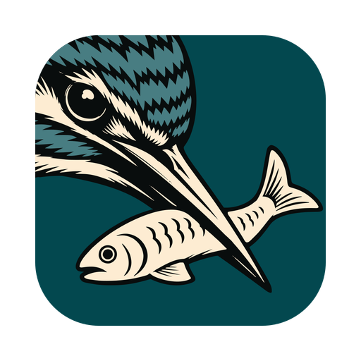

# ArtCraft Quick Look

Select an ArtCraft project or an SVG file in Finder and press **Space** to see what's inside. Select several revisions and use the arrow keys to flip through them. ArtCraft Quick Look adds both the thumbnails in your folders and the larger, static previews.

**[Download for macOS](https://github.com/Roccobot/CraftLook/releases/latest)** · [Guida in italiano](README.it.md)

## Try it

1. Download the ZIP from the [latest release](https://github.com/Roccobot/CraftLook/releases/latest). It includes the renderers and supports Intel and Apple silicon Macs running macOS 13 or later.
2. Unzip the download, move **ArtCraft Quick Look** into **Applications**, and open it once. This build is ad hoc signed and hasn't been notarized by Apple. Gatekeeper may ask for approval on the first launch. [Apple's guide](https://support.apple.com/en-us/102445)
3. In Finder, select a supported file and press **Space**. If Finder shows only a generic icon, check that the ArtCraft Quick Look extensions are enabled in System Settings and that **Show icon preview** is on in Finder's View Options.

You can try it with [River Study, a small VectorCraft project](https://raw.githubusercontent.com/Roccobot/CraftLook/main/examples/river-study.vectorcraft). Save the file with its `.vectorcraft` extension. The image below is the thumbnail macOS generated from that file.


## Supported files

| App or format | Extension | What you see |
| --- | --- | --- |
| FigCraft | `.figcraft` | A rendered layout. A saved thumbnail can also supply the preview. |
| DesignCraft | `.designcraft` | A rendered design, with the saved preview as a fallback. |
| VectorCraft | `.vectorcraft` | The first artboard from an embedded PDF, a saved preview, or a freshly rendered artboard. Gzip-compressed projects are supported. |
| TextureCraft | `.tcraft` | The saved thumbnail or a rendered view of the project. |
| PhotoCraft | `.pcraft` | The best available saved composite or thumbnail, from a project archive or package. |
| SolidCraft | `.sc`, `.solidcraft` | A rendered view of the design, without the ground grid and the axes. |
| FilmCraft | `.fcproj` | The frame of the active sequence at the saved playhead. |
| MaterialCraft | `.mcraft` | The material rendered on the app's 3D scene. |
| EffectCraft | `.ecproj`, `.ecprojx` | The active composition at its current time. |
| Photoshop document | `.psd` | The composite that macOS ImageIO can read. Photoshop is optional. |
| SVG image | `.svg` | The drawing rendered by VectorCraft, text included. |

FigCraft and DesignCraft previews can reach 2048 pixels on the longest side. Finder thumbnails prefer a saved image when available. The bundled renderers run locally, through a sandboxed service, on a temporary copy of the requested file. Projects that rely on files outside the project may look different: a FilmCraft frame that shows media from other files has no preview, because the renderer can't read them. Rendering has a 12-second time limit and a 256 MiB input limit.

PdfCraft works on standard PDF files, which macOS previews by itself. SoundCraft sessions don't contain an image, and the SoundCraft command-line tool doesn't draw one, so `.scraft` files keep their icon.

macOS uses one Quick Look extension for each file type. If another app also previews SVG files, such as Looq or Gapplin, turn its extension off in System Settings, under General, Login Items & Extensions, Quick Look, so that ArtCraft Quick Look shows them.

## Build from source

Use a Mac with Xcode Command Line Tools and Python 3. The preparation script downloads the pinned universal CLI releases listed in [THIRD_PARTY.md](THIRD_PARTY.md), checks their SHA-256 digests and preserves their notices.

```sh
python3 scripts/prepare_renderers.py "$PWD/engines"
./build.sh "$PWD/build" "$PWD/engines"
```

The result is `build/ArtCraft Quick Look.app`. To use previously downloaded upstream ZIPs, pass `--archives /path/to/archives` to the Python script. For a smaller build that reads only embedded previews, run `./build.sh "$PWD/build-embedded"` in a fresh build directory.

After building, run the document-reader checks with these commands.

```sh
xcrun swiftc Sources/Archive.swift Sources/DocumentImage.swift Tests/RenderCheck.swift -o build/rendercheck
python3 Tests/check.py build/rendercheck
```

The renderer checks write a small project for each format that only a renderer can show, with that renderer's own command-line tool, then render them.

```sh
python3 Tests/samples.py "$PWD/engines" build/samples
xcrun swiftc -parse-as-library Sources/Archive.swift Sources/DocumentImage.swift Sources/RenderXPC.swift Sources/HeadlessRenderer.swift Tests/HeadlessCheck.swift -o build/headlesscheck
build/headlesscheck "build/ArtCraft Quick Look.app/Contents/PlugIns/Thumbnail.appex/Contents/XPCServices/CraftRender.xpc/Contents/Helpers" build/samples/* examples/river-study.vectorcraft
```

## Format sources

- [FigCraft](https://github.com/storytold/figcraft/blob/main/crates/format/src/lib.rs)
- [DesignCraft](https://github.com/storytold/craft-libs/blob/main/crates/designcraft-format/src/lib.rs)
- [VectorCraft](https://github.com/storytold/vectorcraft/blob/main/crates/format/src/lib.rs)
- [TextureCraft](https://github.com/storytold/texturecraft/blob/main/crates/formats/src/project_file/mod.rs)
- [PhotoCraft](https://github.com/storytold/photocraft/blob/main/book/src/formats/pcraft.md)
- [SolidCraft](https://github.com/tangency-labs/solidcraft), [FilmCraft](https://github.com/storytold/filmcraft), [MaterialCraft](https://github.com/storytold/materialcraft/blob/main/packaging/macos/Info.plist.in) and [EffectCraft](https://github.com/storytold/effectcraft): the type each app declares, and the image its command-line tool renders
- [Apple Quick Look UI](https://developer.apple.com/documentation/quicklookui/qlpreviewprovider) and [Quick Look Thumbnailing](https://developer.apple.com/documentation/quicklookthumbnailing/qlthumbnailprovider)

## Feedback and credits

For a blank or incorrect preview, include the extension, the macOS version, the version of the app that saved the file and, if possible, a small project you can share. [Report a preview issue](https://github.com/Roccobot/CraftLook/issues/new?template=preview.yml)

ArtCraft Quick Look is an independent community project. The renderers come from the ArtCraft team, from Tangency Labs for SolidCraft, and from their contributors. [Upstream releases and credits](THIRD_PARTY.md)

The Swift code, build scripts and tests are available under the [MIT license](LICENSE). The kingfisher icon has [separate artwork terms](ARTWORK.md).
